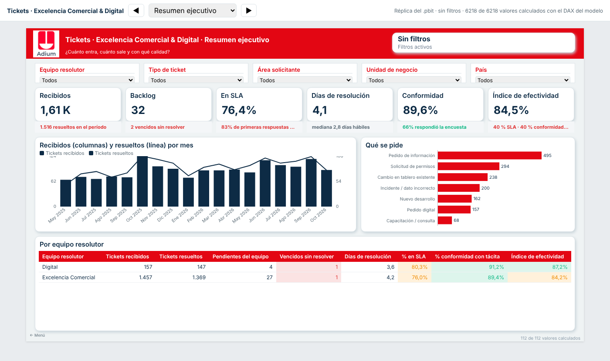

# Tickets · Excelencia Comercial & Digital (Adium)

La mesa de pedidos de **Excelencia Comercial y Digital**, los dos equipos
mancomunados que dan el servicio. Cualquier persona de Adium escribe a la
casilla del área, o usa el portal, y su pedido pasa a ser un ticket con:

- **quién lo pide:** nombre, mail, área solicitante y país;
- **qué pide:** el tipo de ticket (nuevo desarrollo, pedido de información,
  solicitud de permisos, incidente, cambio en un tablero, pedido digital,
  capacitación) y su subtipo;
- **sobre qué:** ATC, área terapéutica, unidad de negocio, mercado conformado
  de HQ, fuente de datos y tablero;
- **quién lo tiene:** equipo resolutor y analista;
- **cada estado con su fecha y hora:** Nuevo → Asignado → En curso → En
  espera del solicitante → Resuelto → Cerrado, o Reabierto / Cancelado, con
  subestados;
- **SLA en horas hábiles**, con el reloj detenido mientras se espera al
  solicitante, y una **matriz tipo × prioridad**;
- **conformidad:** al resolverlo, el solicitante recibe «¿Quedó conforme?» con
  una nota de 1 a 5. Si dice que no, el ticket se reabre; si no contesta en 3
  días hábiles, se cierra con conformidad tácita.

Todo se mide en un **tablero de Power BI de 8 páginas**: tickets mensuales,
quién pide y de qué área, qué se pide, tiempos y SLA, el rendimiento del
equipo, la conformidad y el backlog. Cada KPI se verifica contra la app antes
de entregarse. El diseño es el de la suite **Adium All in One**: los colores y
el logo del informe corporativo, y el tablero lo arma su mismo motor (MV DAX
Lab).



## Dos formas de correrla

| | **Power Platform** (corporativo, recomendado) | **App de Python** (piloto, sin pedirle nada a IT más que la casilla) |
|---|---|---|
| Dónde corre | Microsoft 365: Power Apps + Power Automate + listas de SharePoint | Una PC o VM del equipo |
| Login | El de Microsoft | Detrás del proxy/SSO corporativo |
| Licencias | Las de M365 (sólo conectores estándar) | Ninguna |
| Guía | [`powerapps/`](powerapps/README.md) | Este README |
| Tablero | `exportar_powerbi.py --origen sharepoint` | `exportar_powerbi.py` |

Las dos comparten **una sola definición** de catálogos, estados, SLA e
indicadores (`tickets_ec/`). El paquete de Power Platform (listas, opciones,
reglas del clasificador, fórmulas de Power Apps) **se genera** desde ahí con
`python scripts/generar_powerplatform.py`.

## Correr la app

```bash
pip install -r requirements.txt
python -m tickets_ec.demo                  # 18 meses simulados (personas ficticias, @adium-demo.test)
streamlit run app/app.py                   # http://localhost:8750
```

En Windows: doble clic en `Abrir Tickets EC.bat`.

| Página | Qué hace |
|---|---|
| 🏠 Inicio | Pendientes, vencidos, esperando conformidad y «Mis tickets» con chip de estado |
| 📥 Bandeja | Filtros por equipo, estado, tipo, área solicitante, analista, prioridad, área terapéutica y unidad de negocio, con semáforo de SLA |
| 🎫 Ticket | La banda «En curso desde hace…», las acciones, la conversación y el panel **Datos del ticket** |
| ➕ Nuevo pedido | Alta de lo que llega por Teams o por teléfono, con la clasificación automática a la vista |
| 📨 Casilla | Procesar la casilla, subir un `.eml` y ver la bandeja de salida |
| 📊 Indicadores | Los KPIs con semáforo, mes a mes y abiertos por área, tipo, unidad de negocio, analista y país |
| 📤 Power BI | Exportar los datos y bajar el `.pbit`, el proyecto PBIP para Fabric y la réplica HTML |
| ⚙️ Configuración | Alta de analistas de cada equipo, matriz de SLA, tipos y subtipos |

La **encuesta** es la única página que ve el solicitante: entra desde el link
de su correo (`?encuesta=<token>`). En la base se guarda el hash del token,
nunca el token.

## La casilla

La crea IT como buzón compartido de Exchange Online. El pedido listo para
mandar y las tres formas de conectarla están en [`docs/CASILLA.md`](docs/CASILLA.md).
Para procesarla cada 5 minutos: `scripts\procesar_casilla.bat` en el
Programador de tareas de Windows. **El envío de correos sale apagado**: hasta
activarlo, cada correo queda como `.eml` en `datos/salida/`.

## Power BI y Fabric

```bash
python powerbi/armar_tablero.py            # .pbit + PBIP (.zip) + réplica HTML + VERIFICACION.md
python powerbi/publicar_fabric.py --ver    # qué publicaría en Fabric por API
```

El `.pbit` se abre en Desktop y se guarda como **`.pbix`**: un `.pbix` con
datos sólo lo escribe Power BI Desktop. El proyecto **PBIP** es el formato de la
integración con Git de Fabric. Todos los pasos están en
[`docs/POWERBI.md`](docs/POWERBI.md) y las definiciones de cada KPI en
[`docs/INDICADORES.md`](docs/INDICADORES.md).

## Estructura

```
tickets_ec/       el motor, sólo con la biblioteca estándar
  catalogos.py      estados, transiciones, tipos y subtipos, SLA, áreas, unidades de negocio, ATC
  servicio.py       la mesa (Mesa): crear, asignar, tomar, pedir dato, resolver, encuesta, cierre tácito
  correo.py         leer correos (carpeta / Graph / IMAP), anti-bucles, hilos por [EC-00042]
  clasificador.py   tipo, subtipo, prioridad, equipo, ATC, mercado y fuente, con el porqué
  sla.py            horas hábiles, reloj detenido, vencimiento
  exportar.py       el modelo estrella (Tickets, Estados, Encuestas, Calendario)
  indicadores.py    los KPIs en Python (la misma definición que el DAX)
  sharepoint.py     las listas de Power Platform: esquema y lectura por Graph o CSV
  demo.py           18 meses simulados pasando por la misma mesa
app/app.py        la app Streamlit
powerbi/          medidas DAX, páginas, build verificado, publicación en Fabric
powerapps/        guía, flujos, pantallas, script PnP y catálogos generados
sql/              el mismo esquema para SQL Server (se genera, no se aplica)
scripts/          procesar la casilla, exportar a Power BI, generar Power Platform, E2E
docs/             casilla, indicadores, Power BI / Fabric
```

## Tests

```bash
ruff check .
python -m pytest -q tests                  # 57 tests; el del tablero necesita la suite al lado
python scripts/e2e_ui.py                   # la app de verdad, en Chromium
```

## Datos

La demo es **100 % sintética**, con semilla fija: personas ficticias, correos en
un dominio que no existe y pedidos inventados. Los mercados conformados y los
ATC son los de la definición de HQ, que es una regla de negocio y no un dato de
nadie. La base de la mesa (`datos/`) está en `.gitignore`: los datos reales no
se commitean.
